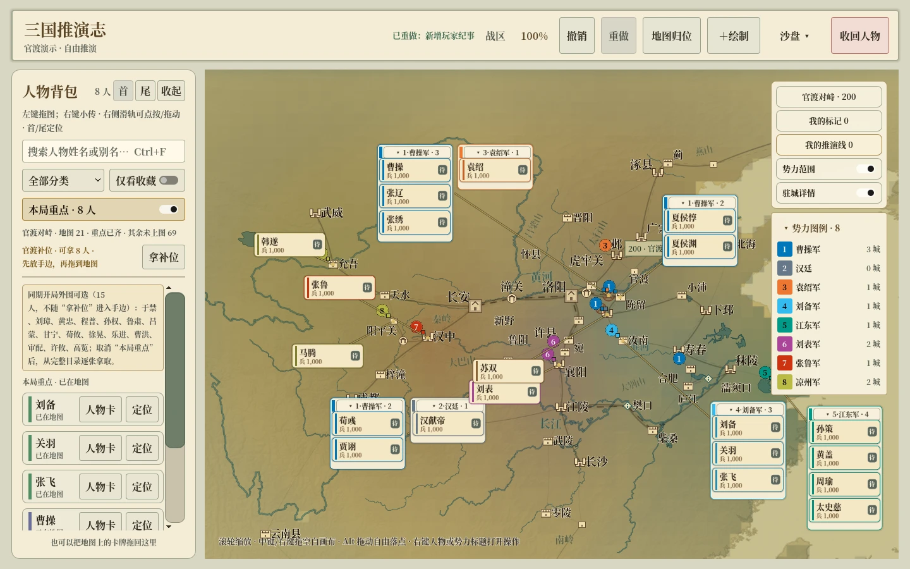
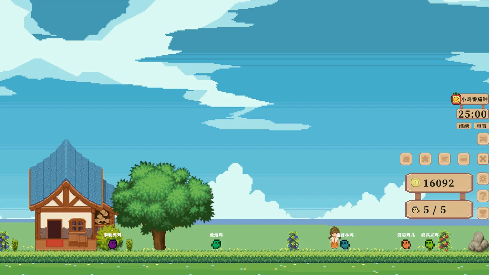
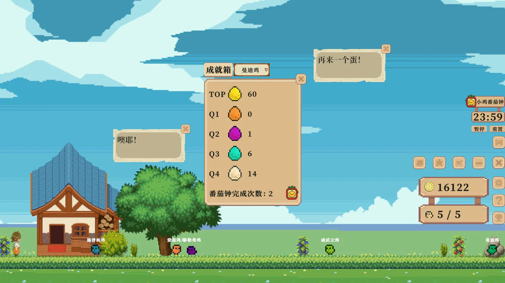
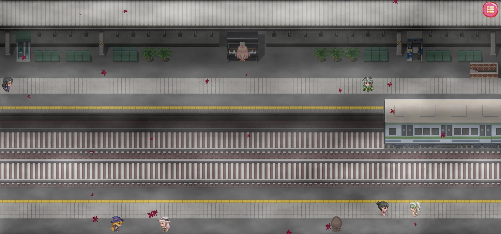
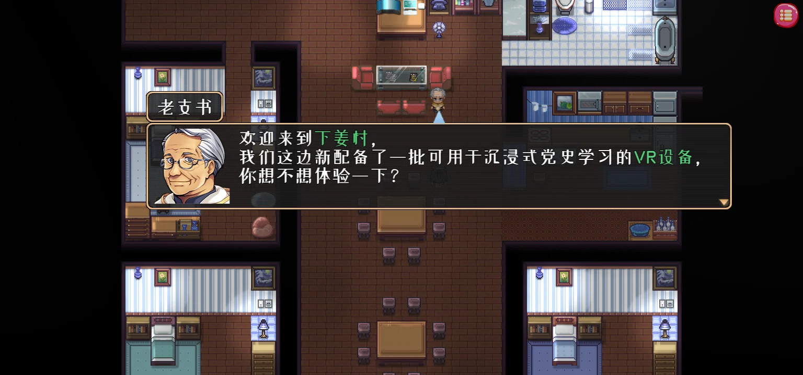
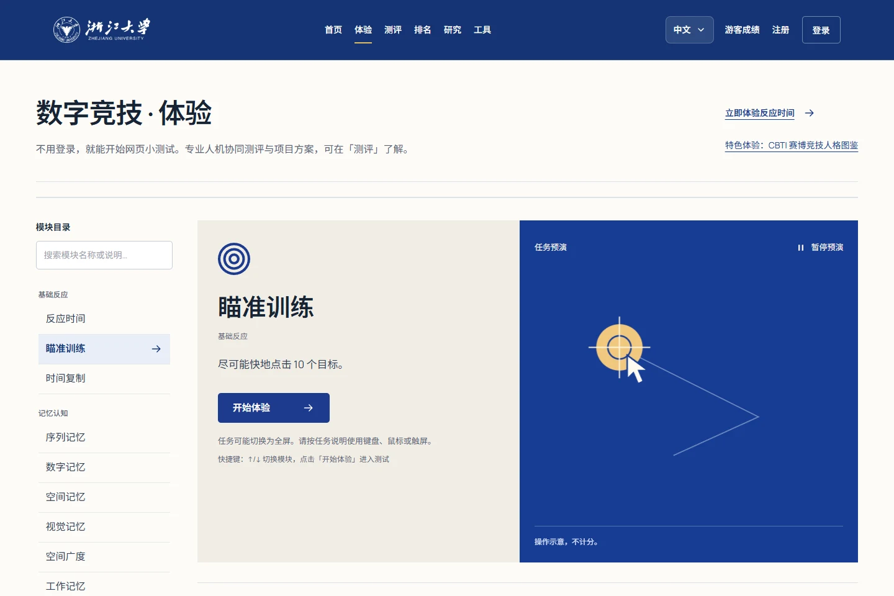
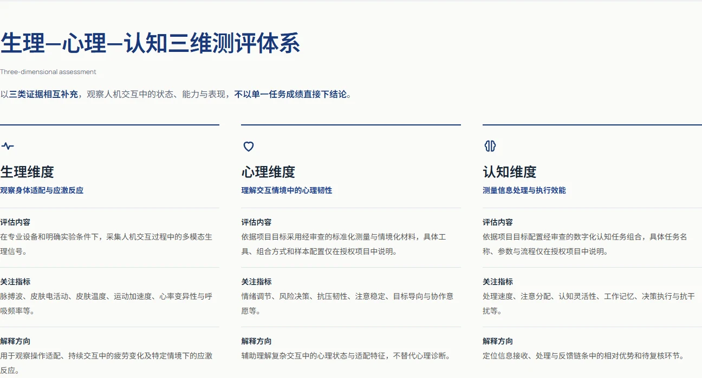
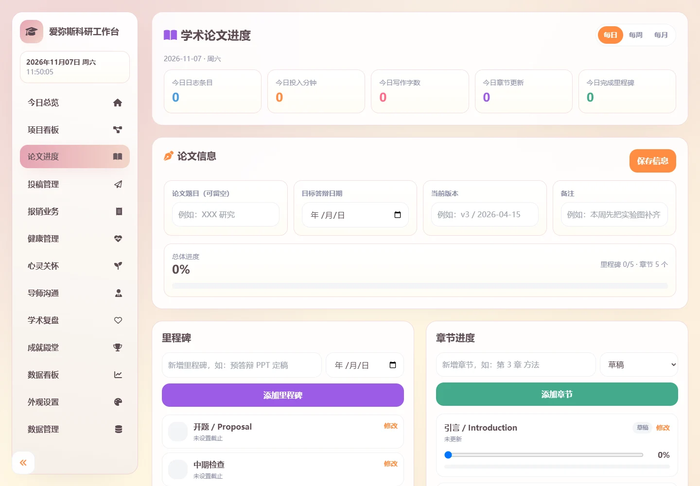
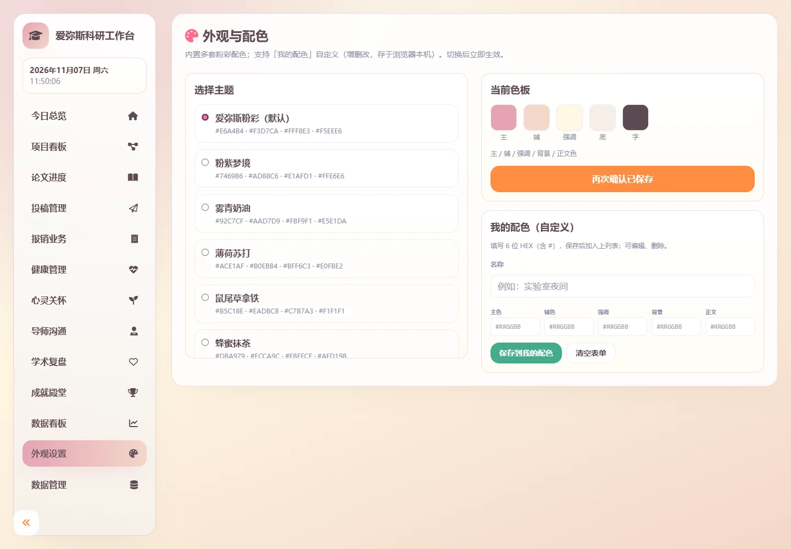




<section class="home-intro">

  <strong>Minkai Wang (王珉锴)</strong> is a <strong>Ph.D. student in Educational Technology at Zhejiang University</strong>. His research spans game-based learning, artificial intelligence in education, and esports education. During his master's studies, he undertook joint training in esports education at the Future Imaging Laboratory, Zhejiang University Yangtze River Delta Smart Oasis Innovation Center. He currently serves as an <strong>R&amp;D Engineer</strong> at the Zhejiang University Yangtze River Delta Smart Oasis–NetDragon International Joint R&amp;D Center for Esports Education and as an <strong>External Expert</strong> at the Zhejiang-Netherlands Joint Laboratory on Digital Diagnosis and Treatment of Oral Diseases, Hangzhou.

  His research examines how large language models, virtual agents, adaptive mechanisms, and digital games can reshape learning experience, engagement, cognitive load, and behavioral patterns. His academic work has appeared in <em>Journal of Computer Assisted Learning</em>, <em>Journal of Educational Computing Research</em>, and <em>Entertainment Computing</em>.

</section>

<section class="home-section home-section--news" aria-labelledby="news">
<h2 id="news">News</h2>

  <ul class="news-list">
    <li><em>Sept 2026</em> Fully immersed in research and classes, with no escape in sight~</li>
    <li><em>Aug 2026</em> Reviewing and consolidating the work from my master's studies, then setting off into the wider universe of research!</li>
  </ul>

</section>
<section class="home-section home-section--tint" aria-labelledby="experience">
<h2 id="experience">Experience</h2>

  <article class="experience-card">
    
Expected Sept 2026

    

      <strong>Zhejiang University</strong>
      Ph.D. Student in Educational Technology | Supervisor: Prof. Xuesong Zhai
    

  </article>

  <article class="experience-card">
    
Mar 2026 - Jul 2026

    

      <strong>Zhejiang University Yangtze River Delta Smart Oasis Innovation Center · Future Imaging Laboratory</strong>
      Joint training student in esports education | Supervisor: Yupei Zhao
    

  </article>

  <article class="experience-card">
    
Current appointment

    

      <strong>Zhejiang University Yangtze River Delta Smart Oasis–NetDragon International Joint R&amp;D Center for Esports Education</strong>
      R&amp;D Engineer
    

  </article>

  <article class="experience-card">
    
Jan 2026 - Dec 2028

    

      <strong>Zhejiang-Netherlands Joint Laboratory on Digital Diagnosis and Treatment of Oral Diseases, Hangzhou</strong>
      External Expert | Three-year appointment
    

  </article>

  <article class="experience-card">
    
Sept 2023 - June 2026

    

      <strong>Zhejiang University of Technology</strong>
      Master in Educational Technology | Supervisor: Prof. Jingdong Zhu
    

  </article>

  <article class="experience-card">
    
Sept 2019 - June 2023

    

      <strong>Zhejiang Shuren University</strong>
      Bachelor in Digital Media Technology | Supervisor: Hanjie Gu
    

  </article>

  <article class="experience-card">
    
Sept 2017 - Sept 2019

    

      <strong>Chinese People's Liberation Army</strong>
      Soldier, Strategic Support Force
    

  </article>

</section>
<section class="home-section" aria-labelledby="publications">
<h2 id="publications">Publications</h2>

<h3 class="section-kicker">Full Publications List</h3>

  <ul class="full-publication-list">
    <li>npj DM Published Intervention fidelity and competency translation of serious games in pharmacy education: a scoping umbrella review Yu, Y.†, <strong>Wang, M.†</strong>, Gong, Y., Zhang, D., Wu, F., &amp; Gu, H. (2026). <em>npj Digital Medicine</em>. (†Co-first author; IF = 18.0) <a href="https://doi.org/10.1038/s41746-026-03182-4" target="_blank" rel="noopener">[Link]</a></li>
    <li>CSSCI What Should Education Be in the Intelligent Era? A Review of the 2026 World Digital Education Conference Zhai, X., <strong>Wang, M.</strong>, Cheng, L., &amp; Zhao, C. (2026). <em>Open Education Research</em>, 32(3), 59-66. (CSSCI, Composite IF = 11.401) <a href="https://openedu.sou.edu.cn/frontsite/series_details.aspx?id=2800" target="_blank" rel="noopener">[Link]</a></li>
    <li>JECR Generative Scaffolding in Pre-Trip Games: Effects of a GenAI-Chatbot on Inquiry-Based Learning Chen, Q., Gong, Y., <strong>Wang, M.</strong>, Lin, J., Gu, H., Peng, H., &amp; Chi, H. (2026). <em>Journal of Educational Computing Research</em>. Advance online publication. (JCR Q1, IF = 8.5) <a href="https://doi.org/10.1177/07356331261474369" target="_blank" rel="noopener">[Link]</a></li>
    <li>JCAL Boosting Student Engagement in STEM: Integrating Large Language Model-Based Virtual Agents Into Alternate Reality Games <strong>Wang, M.</strong>, Zhu, J., Hwang, G., Chang, S., Yang, Q., &amp; Zhang, D. (2025). <em>Journal of Computer Assisted Learning</em>, 41(6). (JCR Q1, IF = 4.6) <a href="https://onlinelibrary.wiley.com/doi/abs/10.1111/jcal.70139" target="_blank" rel="noopener">[Link]</a></li>
    <li>JECR ESI Highly Cited Effects of Incorporating a Large Language Model-Based Adaptive Mechanism Into Contextual Games on Students' Academic Performance, Flow Experience, Cognitive Load and Behavioral Patterns <strong>Wang, M.</strong>, Zhang, D., Zhu, J., &amp; Gu, H. (2025). <em>Journal of Educational Computing Research</em>, 63(3), 662-694. (JCR Q1, IF = 8.5) <a href="https://journals.sagepub.com/doi/abs/10.1177/07356331251321719" target="_blank" rel="noopener">[Link]</a></li>
    <li>EC Optimizing experiential learning in science education: The role of two-tier testing in digital game-based learning <strong>Wang, M.</strong>, Zhu, J., Gu, H., Zhang, J., Wu, D., &amp; Wang, P. (2025). <em>Entertainment Computing</em>, 54, 100960. (JCR Q2, IF = 2.4) <a href="https://www.sciencedirect.com/science/article/pii/S1875952125000400" target="_blank" rel="noopener">[Link]</a></li>
    <li>EC Integrating artificial intelligence and gamification in rehabilitation: A scoping review <strong>Wang, M.</strong>, Zhu, J., Qian, W., &amp; Gu, H. (2025). <em>Entertainment Computing</em>, 55, 101011. (JCR Q2, IF = 2.4) <a href="https://www.sciencedirect.com/science/article/pii/S1875952125000916" target="_blank" rel="noopener">[Link]</a></li>
    <li>EC Beyond pre-scripted interactions: Mapping the integration of LLMs in digital game-based learning - a scoping review Gong, Y., <strong>Wang, M.</strong>, Tu, Y., Huang, C., &amp; Zhang, D. (2026). <em>Entertainment Computing</em>, 56, 101082. (JCR Q2, IF = 2.4) <a href="https://www.sciencedirect.com/science/article/pii/S1875952126000042" target="_blank" rel="noopener">[Link]</a></li>
    <li>JECR Asking, Playing, Learning: Investigating Large Language Model-Based Scaffolding in Digital Game-Based Learning for Elementary Artificial Intelligence Education Gong, Y., <strong>Wang, M.</strong>, He, L., Xu, C., &amp; Yu, Y. (2025). <em>Journal of Educational Computing Research</em>, 64(2), 311-343. (JCR Q1, IF = 8.5) <a href="https://journals.sagepub.com/doi/abs/10.1177/07356331251396354" target="_blank" rel="noopener">[Link]</a></li>
    <li>AS The Impact of a Digital Game-Based AI Chatbot on Students' Academic Performance, Higher-Order Thinking, and Behavioral Patterns in an Information Technology Curriculum Xu, Y., Zhu, J., <strong>Wang, M.</strong>, Qian, F., Yang, Y., &amp; Zhang, J. (2024). <em>Applied Sciences</em>, 14(15): 6418. (JCR Q2, IF = 2.9) <a href="https://www.mdpi.com/2076-3417/14/15/6418" target="_blank" rel="noopener">[Link]</a></li>
    <li>AS The Effectiveness of a Digital Twin Learning System in Assisting Engineering Education Courses: A Case of Landscape Architecture Zhang, J., Zhu, J., Tu, W., <strong>Wang, M.</strong>, Yang, Y., Qian, F., &amp; Xu, Y. (2024). <em>Applied Sciences</em>, 14(15): 6484. (JCR Q2, IF = 2.9) <a href="https://www.mdpi.com/2076-3417/14/15/6484" target="_blank" rel="noopener">[Link]</a></li>
  </ul>
  
Journal metrics reflect the most recently verified information for each entry; impact factors are journal-level indicators. The ESI Highly Cited status follows the supplied Web of Science record and may change with ESI updates.

</section>
<section class="home-section home-section--tint" aria-labelledby="projects">
<h2 id="projects">Projects</h2>

  

    

      
      
    

    

      <strong>Three Kingdoms Sandtable</strong> 
      <i>An offline, single-player Godot sandbox inspired by childhood games with Three Kingdoms character cards.</i> 
      Arrange 90 characters across six starting scenarios, decide their movements, factions, and battle outcomes, and preserve your own Three Kingdoms story through named snapshots and chronicles. 
      <b><i>Open-source Game</i></b> <a href="https://github.com/minkaiwang/sanguo-sandtable" target="_blank" rel="noopener">[GitHub]</a> <a href="https://github.com/minkaiwang/sanguo-sandtable/releases" target="_blank" rel="noopener">[Windows]</a>
      <small class="project-credit">Code licensed under MIT; see the repository for historical-source and asset credits.</small>
    

  

  

    

      
      
      
    

    

      <strong>Waiting for an Egg</strong> 
      <i>Pixel-art idle desktop companion released on Steam on 27 May 2026.</i> 
      Built around focus and patience: raise eight chicken breeds, wait through review cycles, collect five tiers of Inspiration Eggs, and use a focus timer, saved notes, and an adjustable desktop window. 
      <b><i>Game Project</i></b> <a href="https://store.steampowered.com/app/4145110/__Waiting_for_an_Egg/" target="_blank" rel="noopener">[Steam]</a>
    

  

  

    

      
      
      
    

    

      <strong>Sprout's Journey</strong> 
      <i>Campus navigation educational game released on itch.io.</i> 
      A campus navigation and role-based learning project combining digital media design and educational interaction. 
      <b><i>Game Project</i></b> <a href="https://charmpoint.itch.io/xiaoshuya-chufa" target="_blank" rel="noopener">[itch.io]</a> <a href="https://weixin.qq.com/sph/ATvJNCy68L" target="_blank" rel="noopener">[Video]</a>
    

  

  

    

      
      
      
    

    

      <strong>Centennial Shuttle</strong> 
      <i>Red tourism educational game released on itch.io.</i> 
      A role-playing educational game that supports red culture learning through scenario-based exploration. 
      <b><i>Game Project</i></b> <a href="https://charmpoint.itch.io/bncsj" target="_blank" rel="noopener">[itch.io]</a> <a href="https://weixin.qq.com/sph/AMLBDMhxYC" target="_blank" rel="noopener">[Video]</a>
    

  

  

    

      
      
      
      
    

    

      <strong>Digital Esports Potential Assessment System</strong> 
      <i>A web system co-designed / co-developed for esports assessment.</i> 
      The system supports player profiling, growth tracking, practice experiences, assessment tasks, rankings, and data-driven feedback. 
      <b><i>Web Project</i></b> <a href="https://www.esports-data.online/assessment/" target="_blank" rel="noopener">[Website]</a>
    

  

  

    

      
      
      
    

    

      <strong>Aemeath Academic Desktop Assistant</strong> 
      <i>A Windows desktop pet integrated with a local-first research workbench.</i> 
      An integration, adaptation, and maintenance project combining an AI desk pet, chat / tray interactions, and paper, project, and task tracking in one desktop workflow. 
      <b><i>Open-source Integration</i></b> <a href="https://github.com/minkaiwang/AemeathDeskPet" target="_blank" rel="noopener">[GitHub]</a>
      <small class="project-credit">The desk-pet baseline follows the FlyingSnowVelvet-Aemeath lineage, and the workbench draws on AugustUp/phd_master_system; see the repository for full credits and asset terms.</small>
    

  

  

    

      
      
    

    

      <strong>WeddingSeats: Seating &amp; Lottery Integration</strong> 
      <i>A connected workflow for wedding seating, guest export, and live lottery.</i> 
      An integration and event customization project supporting drag-and-drop seating, Excel export, one-click import, live list synchronization, and optional cloud backup. 
      <b><i>Open-source Integration</i></b> <a href="https://github.com/minkaiwang/wedding-seating-lottery" target="_blank" rel="noopener">[GitHub]</a>
      <small class="project-credit">Seating is based on Ajdin Catic / wedding-seats and lottery on LOG1997 / log-lottery; see the repository for full credits.</small>
    

  

</section>
<section class="home-section" aria-labelledby="grants">
<h2 id="grants">Research Grants</h2>

<ol class="compact-list">
  <li><strong>Host</strong> | Zhejiang University of Technology "Canal Cup" Key Project: Research on the Application of LLM Virtual Agents Replacing Reality Games in STEAM Education (2024-2025)</li>
  <li><strong>Host</strong> | Zhejiang University of Technology "Canal Cup" Key Project: Design and Practice of LLM-Driven Adaptive Science Education Contextual Games (2024-2025)</li>
  <li><strong>Participant</strong> | Zhejiang Educational Technology Center Project: Theme Science Museum - Primary School Practical Education in the Digital Intelligence Era (2023-2024)</li>
  <li><strong>Participant</strong> | Ministry of Education National Innovation and Entrepreneurship Training Program: Deep Development of "Immersive Red Tour" Digital Red Tourism Application (2022-2023)</li>
  <li><strong>Host</strong> | Zhejiang Provincial Innovation and Entrepreneurship Training Program: Research and Development of Role-Playing Based Campus Navigation Game (2021-2022)</li>
</ol>

  <strong>Other Participated Projects / Programs</strong>
  <ul class="two-column-list">
    <li>Dongtou PBL Gamified Practice Education Curriculum Development</li>
    <li>Zhejiang University Digital Esports Experience / Practice / Assessment System</li>
    <li>Research on Excellent AI Education Teaching Cases for Primary and Secondary Schools</li>
    <li>Geely Automobile Industry Sci-Tech Innovation Practice Education Base</li>
    <li>Intelligent Learning Space for Motor Skills</li>
    <li>Cultivation of New Comprehensive Practical Education Venues</li>
    <li>Theoretical Research and Technical Service for Project-Based Learning Activities in Wuzhong District</li>
    <li>"Moral Education in Subject Courses" Classroom Teaching Cases</li>
    <li>Digital-Intelligence Garden Reading-and-Farming Learning Space</li>
  </ul>

</section>
<section class="home-section home-section--tint" aria-labelledby="awards">
<h2 id="awards">Awards</h2>

  <ul class="compact-list">
    <li><strong class="key-achievement">Provincial Outstanding Graduate, National Scholarship, and University Graduate Academic Star Award</strong>, plus a First-Class Academic Scholarship during master's study.</li>
    <li><strong class="key-achievement">University Outstanding Graduate</strong>, University Outstanding Undergraduate Thesis, University Outstanding Student Party Member, and Outstanding Youth League Cadre during undergraduate study.</li>
    <li>Third Prize in NCDA Zhejiang Division; Second Prize in Zhejiang Provincial University Multimedia Works Design Competition.</li>
    <li>Main referee for the Matata category, 2025 World Robot Contest Youth Robot Design Contest, Hangzhou Selection.</li>
    <li>Excellent Recruit, <strong class="key-achievement">Excellent Conscript and commendation</strong>, and Third Prize in the Team Combat Injury Rescue Competition during military service.</li>
  </ul>

</section>
<section class="home-section" aria-labelledby="services">
<h2 id="services">Professional Service &amp; Engagement</h2>

  <strong>Journal Reviewer</strong>
  <ul class="two-column-list journal-list">
    <li><em>Artificial Intelligence Review</em></li>
    <li><em>npj Digital Medicine</em></li>
    <li><em>International Journal of STEM Education</em></li>
    <li><em>International Journal of Human–Computer Interaction</em></li>
    <li><em>BMC Medical Ethics</em></li>
    <li><em>BMC Medical Education</em></li>
    <li><em>Virtual Reality</em></li>
    <li><em>Humanities &amp; Social Science Communication</em></li>
    <li><em>Journal of Academic Librarianship</em></li>
    <li><em>Cognitive Neurodynamics</em></li>
    <li><em>Universal Access in the Information Society</em></li>
    <li><em>Entertainment Computing</em></li>
    <li><em>Cognitive Development</em></li>
    <li><em>SoftwareX</em></li>
    <li><em>Acta Psychologica</em></li>
    <li><em>Frontiers in Psychology</em></li>
    <li><em>International Journal of Computational Intelligence Systems</em></li>
    <li><em>JoVE - Journal of Visualized Experiments</em></li>
    <li><em>IEEE Access</em></li>
    <li><em>Scientific Reports</em></li>
    <li><em>Frontiers in Rehabilitation Sciences</em></li>
    <li><em>Computers in Human Behavior: Artificial Humans</em></li>
    <li><em>Computers &amp; Education: X Reality</em></li>
    <li><em>Discover Sustainability</em></li>
    <li><em>Social Sciences &amp; Humanities Open</em></li>
    <li><em>Discover Artificial Intelligence</em></li>
    <li><em>Discover Psychology</em></li>
  </ul>

  <strong>Other Professional Service</strong>
  <ul class="compact-list">
    <li>Person in charge of the WeChat Official Account "Digital Game-based Learning Research".</li>
    <li>Deeply participated in the compilation of the <em>Blue Book on Digital Education Development in Zhejiang Province</em>.</li>
    <li>Deeply participated in the compilation of the <em>Development Report on New Comprehensive Practical Education Venues in Zhejiang Province</em>.</li>
  </ul>

  <strong id="talks">Conference and Event Participation</strong>
  <ul class="compact-list">
    <li>The 1st National Symposium on AI-Empowered Interdisciplinary Project-Based Learning (2024, Xiamen) | Attendee</li>
    <li>China Educational Technology Academic Conference (2026, Hangzhou) | Conference support</li>
    <li>Puyuan Esports Summit (2026, Jiaxing) | Attendee</li>
    <li>Asian Young Leaders Salon on "Technology + Esports" (2026, Hangzhou) | Attendee</li>
    <li>National Esports Training Team for the 20th Asian Games (2026, Aichi-Nagoya), training in Kunming (2026) | Research support</li>
    <li>AI Literacy Co-creation Camp for Global South Countries (2026, Hangzhou) | Training support</li>
  </ul>

</section>
<section class="home-section" aria-labelledby="teaching">
<h2 id="teaching">Teaching</h2>

  

    <section class="teaching-group">
      <h3>Teaching and Instruction</h3>
      <ul class="compact-list">
        <li><strong>Nov 2025</strong> | Teaching Assistant | Advanced Workshop on AI Literacy for Primary and Secondary School Teachers in Yuhang District</li>
        <li><strong>Apr - Nov 2025</strong> | Intern Teacher | Jiaxing Experimental Junior High School, Information Technology</li>
        <li><strong>Mar - Jun 2024</strong> | Programming Teacher | Hangzhou Wenxin Primary School and Zhongtai Center Primary School</li>
        <li><strong>Mar - May 2024</strong> | Competition Instructor | Robotic Arm Competition Training for schools in Hangzhou</li>
        <li><strong>Mar 2023 - Dec 2024</strong> | Part-time Teacher | Hangzhou Cuiyuan No. 2 Primary School and programming institutions</li>
        <li><strong>Jul 2020</strong> | Programming Teacher | Jiashan Experimental Primary School</li>
      </ul>
    </section>

    <section class="teaching-group">
      <h3>Study Tour Mentor</h3>
      <ul class="compact-list">
        <li><strong>Jul 2026</strong> | Operation Dawn: Coastal Defense Technology and Martial Spirit Study Tour</li>
        <li><strong>Jun - Jul 2025</strong> | Decoding Zhejiang Science &amp; Technology Genes Study Tour</li>
        <li><strong>Jun - Jul 2024</strong> | Geely Automotive Dream Factory Study Tour</li>
      </ul>

      <h3>Volunteer Service</h3>
      <ul class="compact-list">
        <li><strong>Jul 2024</strong> | Wuxing Village "Holiday School" Mental Health Class</li>
        <li><strong>May 2024</strong> | Hanghai Road Community Neighborhood Youth Center Inquiry-Based Science Class</li>
        <li><strong>Oct - Dec 2023</strong> | Candlelight Volunteer Program - Online Teaching</li>
      </ul>
    </section>

    <section class="teaching-group teaching-group--wide">
      <h3>Other Leadership and Coaching</h3>
      <ul class="compact-list two-column-list">
        <li><strong>Feb 2023 / Feb 2024</strong> | Skiing Instructor | Hai Ben Camps Ski Winter Camp</li>
        <li><strong>2020 - 2022</strong> | Military Instructor | Zhejiang Shuren University, Jiashan No. 2 Senior High School, etc.</li>
        <li><strong>Sept 2018 - Sept 2019</strong> | Squad Leader | Strategic Support Force Unit, PLA</li>
      </ul>
    </section>
  

</section>

